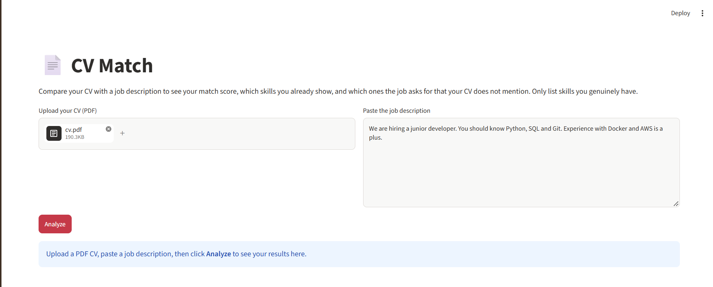
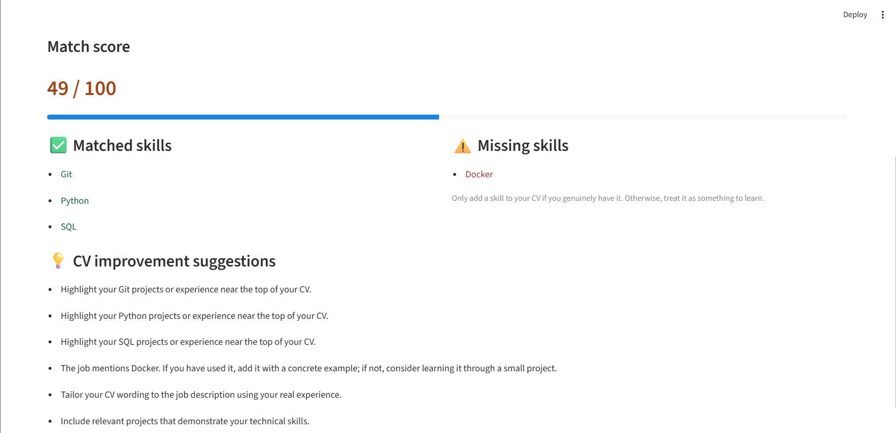

# CV Match

CV Match compares a CV (PDF) with a job description and shows how well they match. It reports a match score, the skills the CV already covers, the skills the job asks for that the CV does not mention, and suggestions for improving the CV.

Built as a 2-person university hackathon project (about 3 hours) at Sukkur IBA University.

## Team

| Member | Role | Owns |
|---|---|---|
| Muhammad Sufian | Frontend / Product | `app.py` (Streamlit UI), `README.md` |
| Baqar Ali | Backend / Matching logic | `cv_parser.py`, `matcher.py`, `skills.py` |

## How it works

1. The user uploads their CV as a PDF and pastes a job description.
2. `cv_parser.extract_text_from_pdf` turns the PDF into text.
3. `matcher.analyze_cv(cv_text, job_description)` compares the two texts.
4. The app displays the result.

The backend returns a dictionary in this fixed format:

```python
{
    "score": int,                # 0-100
    "matched_skills": [str],
    "missing_skills": [str],
    "suggestions": [str],
}
```

Both functions raise `ValueError` on bad input (for example an unreadable PDF or empty text), and the UI shows that as a friendly error message.

## Features

- PDF CV upload
- Job description text input
- Match score from 0 to 100
- Matched skills list
- Missing skills list
- CV improvement suggestions
- Clear error messages for unreadable PDFs or empty input

## Tech stack

- Python
- Streamlit (user interface)
- No paid APIs and no external AI services

## Responsible use

CV Match is a guide, not a verdict. A "missing skill" is a prompt to reflect on your real experience. Only add a skill to your CV if you genuinely have it. Do not invent or exaggerate skills to raise your score.

## Project status

## Screenshots

| Home | Result |
|---|---|
|  |  |

## Installation

Requires Python 3.9 or newer.

```bash
git clone https://github.com/baqar360/cv-match.git
cd cv-match
python -m venv .venv
# Windows (PowerShell):
.venv\Scripts\Activate.ps1
# macOS / Linux:
# source .venv/bin/activate
python -m pip install -r requirements.txt
```

## Run

```bash
python -m streamlit run app.py
```

Open http://localhost:8501, upload a text-based PDF CV, paste a job description (at least 10 words) and click **Analyze**.

## Limitations

- Skills are detected from a fixed list in `skills.py`, so job descriptions with no listed skills return a "no recognizable skills" message instead of a score.
- The CV is read as text. Scanned or image-only PDFs may not work because there is no OCR.
- The score is a simple skill-overlap estimate, not a hiring decision.

## Troubleshooting

- `ModuleNotFoundError: No module named 'fitz'`: run `python -m pip install pymupdf`.
- `DLL load failed ... Application Control policy has blocked this file` (seen on one Windows laptop with PyMuPDF 2.2): install an older version with `python -m pip install pymupdf==1.24.14`.

## Project status

Frontend and backend are connected and tested locally. Deployment: not yet done.